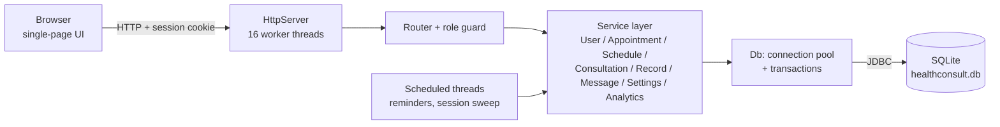
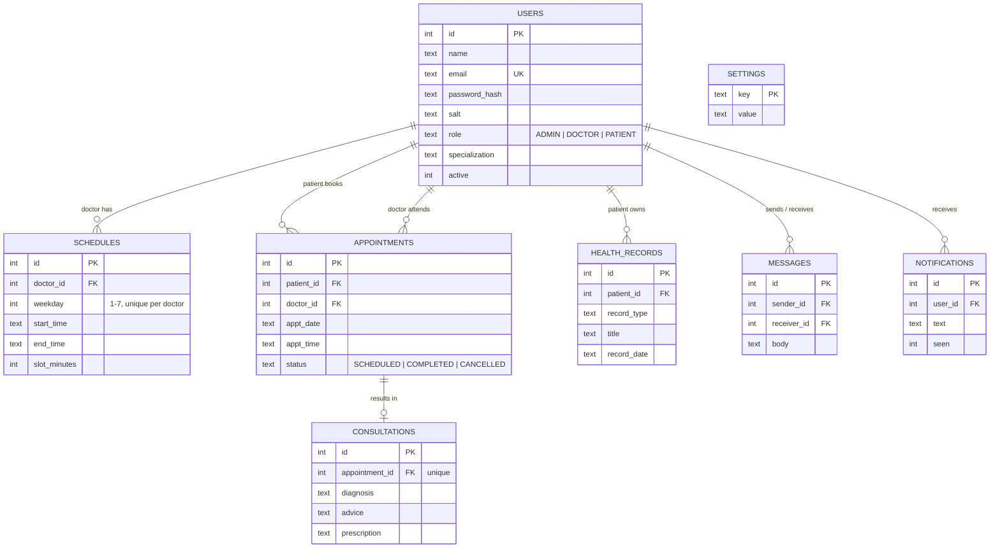
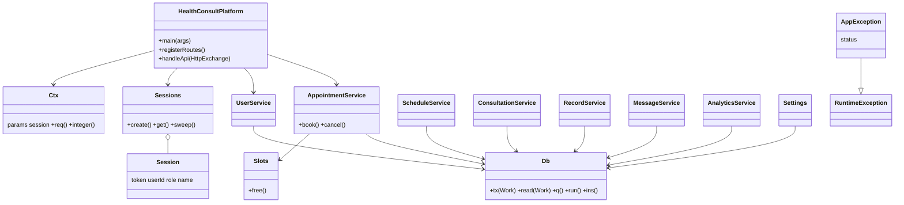
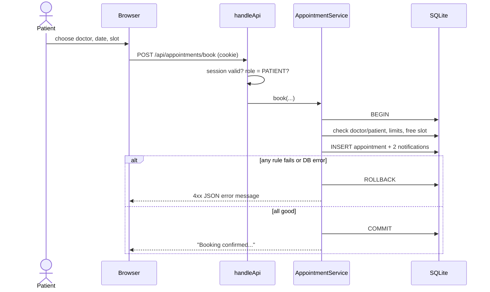

# CareConnect - Online Health Consultation Platform

A complete online health consultation platform written in **pure Java (JDK 17+)**. Patients book appointments with healthcare professionals, receive written medical advice and manage their health records. Professionals manage their schedules, give consultations and read patient files. Administrators manage users, appointments, system settings and view analytics.

The whole application is one source file, `HealthConsultPlatform.java`. It contains the web server, business logic, JDBC data layer and the web UI. The only third-party file is the SQLite **JDBC driver jar**, which any JDBC project needs.

---

## Quick start

**Requirements:** JDK 17 or newer, plus the SQLite JDBC driver jar.

```bash
# 1. Put the JDBC driver in ./lib
mkdir lib
# download from Maven Central:
#   https://repo1.maven.org/maven2/org/xerial/sqlite-jdbc/3.41.2.2/sqlite-jdbc-3.41.2.2.jar
# and save it as lib/sqlite-jdbc-3.41.2.2.jar

# 2. Compile
javac HealthConsultPlatform.java

# 3. Run   (Linux / macOS)
java -cp ".:lib/*" HealthConsultPlatform
#          (Windows)
java -cp ".;lib/*" HealthConsultPlatform
```

Open **http://localhost:8080**. Use another port with `java -cp ".:lib/*" HealthConsultPlatform 9090`.

If you use a newer sqlite-jdbc and see `NoClassDefFoundError: org/slf4j/...`, also put `slf4j-api` in `lib/`. Version 3.41.2.2 needs nothing else.

The database file `healthconsult.db` is created on first run and filled with demo data.

### Demo accounts

| Role | Email | Password |
|---|---|---|
| Admin | admin@careconnect.com | admin123 |
| Healthcare professional | dr.sharma@careconnect.com | doctor123 |
| Healthcare professional | dr.iyer@careconnect.com | doctor123 |
| Healthcare professional | dr.khan@careconnect.com | doctor123 |
| Patient | patient@careconnect.com | patient123 |

The login screen also has tap-to-fill buttons for the three roles.

---

## Features by role

### Admin
| Function | Input | Output |
|---|---|---|
| User management | name, email, role, password, status | Confirmation on create / update / delete |
| Appointment management | patient, professional, date, free slot | Confirmation on scheduling; change status; delete |
| System settings | clinic name, booking window, max upcoming visits, slot length, registration open/closed | Confirmation on update (rules are enforced immediately) |
| System analytics | - | User counts, 7-day appointment chart, status mix, busiest professionals |

### Healthcare professional
| Function | Input | Output |
|---|---|---|
| Schedule management | weekday, start, end, slot length | Confirmation; patients see only the slots generated from these hours |
| Consultation provision | diagnosis, advice, prescription | Confirmation; appointment becomes *completed*; patient is notified |
| Patient record access | Patient ID | Profile, health records and consultation history |
| Communication tools | message text | Chat with patients they have an appointment with |

### Patient
| Function | Input | Output |
|---|---|---|
| Consultation booking | professional, date, time, reason | Booking confirmation |
| Receive medical advice | - | Diagnosis, advice and prescription for each completed visit |
| Health record management | type, title, details, date | Add / edit / delete records |
| Profile management | name, phone, password | Confirmation |

Everyone also gets in-app **notifications** (booking, cancellation, advice ready, 24-hour reminders).

---

## How this maps to the review rubric

| Review criterion | Where it is in the project |
|---|---|
| **Problem understanding and solution design** | Requirements are broken into three roles and nine functions (above). The diagrams below cover architecture, ER design, class design and the booking flow. Code is laid out in numbered sections 1-7 in the source. |
| **Core Java concepts** | **OOP:** enums (`Role`, `Status`), records (`Reply`, `RouteDef`), interfaces (`Route`, `Db.Work<T>`), encapsulated service classes, a custom `AppException`. **Collections:** `ConcurrentHashMap` (sessions), `HashMap` (routes), `LinkedHashMap` / `List<Map>` (query results), `EnumSet`, `HashSet`, `ArrayBlockingQueue` (connection pool). **Exception handling:** `AppException` with HTTP status codes, `try/finally` for connection return, rollback on failure, one central handler that turns errors into JSON. **Threads:** 16-thread worker pool for requests, a `ScheduledExecutorService` for the reminder job and session cleanup, a blocking connection pool, a shutdown hook. |
| **Database integration (JDBC)** | Schema with 8 tables, foreign keys, `CHECK` constraints and a partial unique index (`Schema`). `PreparedStatement` everywhere, so there are no SQL injection paths. CRUD in each service. **Transactions:** `Db.tx(...)` commits on success and rolls back on any error. Booking, cancelling, saving a consultation and settings updates each run as one atomic transaction. |
| **Servlets and web integration** | Request/response handling, routing table, and cookie-based **session management** are implemented on the JDK's built-in `com.sun.net.httpserver`. Sessions use a random 192-bit token in an `HttpOnly; SameSite=Strict` cookie with a 30-minute sliding timeout, and every route is guarded by role. The same concepts as `HttpServlet` and `HttpSession`, without needing Tomcat or Jakarta jars. |

> If your evaluators require the `javax/jakarta.servlet` API specifically, the service and data layers are independent of the web layer. `handleApi` is the only adapter to replace with an `HttpServlet#service` method.

---

## Architecture



## Database design (ER diagram)



A partial unique index on `(doctor_id, appt_date, appt_time) WHERE status <> 'CANCELLED'` guarantees that two patients can never hold the same slot, even if two requests arrive at the same moment.

## Class design



## Booking flow



---

## REST endpoints

All responses are JSON: `{ "ok": true, "message": "...", "data": ... }` or `{ "ok": false, "message": "..." }`.

| Endpoint | Roles |
|---|---|
| `POST /api/login`, `POST /api/register`, `GET /api/public` | public |
| `POST /api/logout`, `GET /api/me`, `POST /api/profile`, `GET /api/notifications` | any signed-in user |
| `GET /api/doctors`, `GET /api/slots`, `GET /api/appointments`, `POST /api/appointments/cancel` | any signed-in user (results are filtered by role) |
| `POST /api/appointments/book` | patient, admin |
| `/api/admin/users`, `/api/admin/users/save`, `/api/admin/users/delete`, `/api/admin/appointments/status`, `/api/admin/appointments/delete`, `/api/admin/settings`, `/api/admin/analytics` | admin |
| `/api/doctor/schedule`, `/api/doctor/schedule/save`, `/api/doctor/schedule/off`, `/api/doctor/consult`, `/api/doctor/patients`, `/api/doctor/patient` | healthcare professional |
| `/api/patient/records`, `/api/patient/records/save`, `/api/patient/records/delete` | patient |
| `/api/messages/contacts`, `/api/messages/thread`, `/api/messages/send` | healthcare professional, patient |

## Security notes

- Passwords are salted and hashed with iterated SHA-256 (JDK `MessageDigest`). Plain passwords are never stored.
- All SQL uses `PreparedStatement`. All user text is HTML-escaped in the UI.
- Role checks happen on the server for every endpoint. A professional can open a patient file only if they have an appointment with that patient. Messaging works only between people who share an appointment.
- For production use, add HTTPS (reverse proxy) and the `Secure` cookie flag, and move to bcrypt/argon2.

## Project structure

```
.
├── HealthConsultPlatform.java   # the whole application
├── README.md
├── .gitignore
└── lib/
    └── sqlite-jdbc-3.41.2.2.jar # download separately (see Quick start)
```

## Possible extensions

Video consultation links, email/SMS reminders, appointment rescheduling, file uploads for lab reports, and a Maven/Gradle build.
